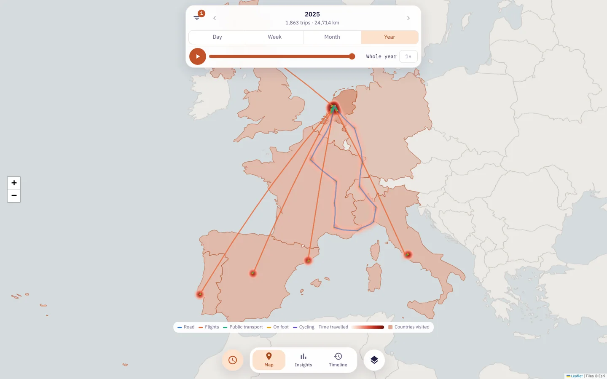
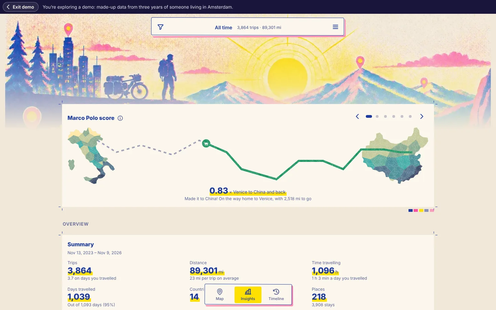
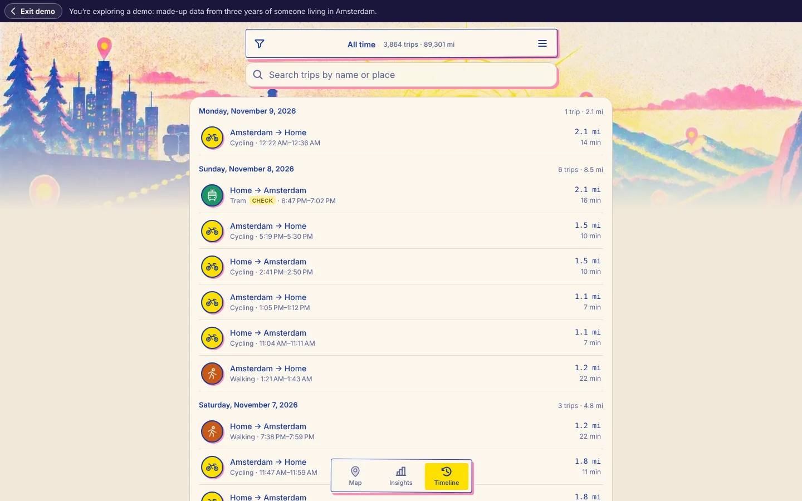
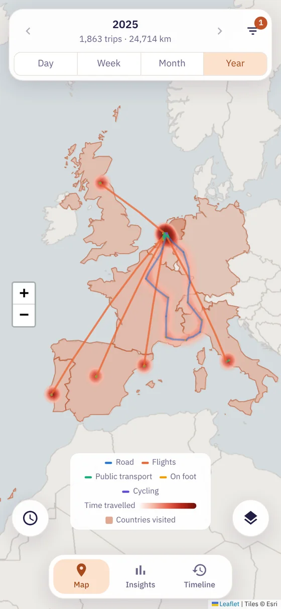
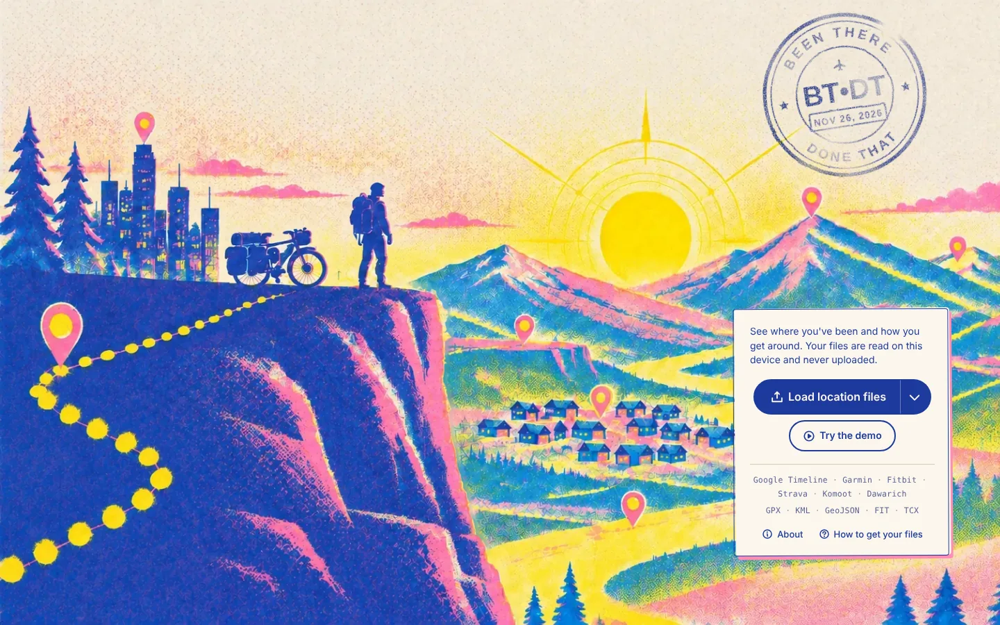

# BT•DT (Been There · Done That)

**A heatmap of everywhere you've been, from your Google Timeline and much more.** Load the Timeline file from your phone, your Garmin, Fitbit or Strava activities, or any GPX, KML, GeoJSON or FIT track, and BT•DT draws every trip, flight and country on a map, lists your days as a timeline, and shows how you get around and what it costs in CO₂. It runs in your browser: your file is read on your device and never uploaded.

### [Open BT•DT →](https://bluehair-co.github.io/btdt/)

Free, no account, no tracking. Works on Android, iPhone, Mac and PC, and installs as an app that opens offline.

Screenshots use made-up demo data. The basemap in them is drawn from the app's built-in country borders; the live app uses Esri map tiles.

## What you get

- **Map.** Every trip drawn along its GPS points and coloured by transport, a heatmap of where you spend your time travelling or staying, countries visited, and your regular places. Play a day, week, month or year back on the time slider. A day's playback shows a small pill under the moving marker with your speed at that moment (km/h or mph, as in Settings) whenever you're on the move, marks sunrise and sunset where you were and shades the night side of the map, and a trip still under way at midnight carries it on into the next day. When filters leave a few trips too small to see at the zoom you're at, a soft beacon marks each of them, and the zoom to all button fits every trip in the filters, with a dot on it when some are out of view. The layers button opens the map sheet: the view, *Colour lines by* (transport, speed, heart rate or no lines), the heatmap, and what goes on top (countries visited, regular places, explorer squares). The pencil button beside it, *Map tools*, holds *Select trips on the map* and *New map snap*.
- **Insights.** Trips, distance, time on the move, countries and places for any period; how you travel by distance, time or trips; your weekly rhythm; distance and CO₂ over time. The cards are grouped under Scores, Overview, Places, Countries, Fitness and CO₂, with a chip for each that stays at the top to jump between them.
- **Timeline.** Every trip, day by day, with where it started and ended, the transport, the distance and the time. Search the trips in your filters by name or place, and tap one to open it, with its map at the top.
- **Filters and export.** Narrow by dates, time of day, transport and country, then download what matches as JSON or CSV.
- **Trips Google merged, split.** When Timeline keeps a train ride, the wait at the station and the tram after it as one trip, BT•DT splits it into legs, each with its own type and line, and names the station from a station pack. Less clear cases are marked *Split?* with a button, and *Keep as one trip* undoes a split. Settings has Automatic, Only suggest or Off. *Split trip* in any trip's details lets you tap its path where each leg ends.
- **Stations and airports in your places.** Places you pass through at a station (with a station pack) or an airport are named and counted as Transport stops or Airports, unless you named them yourself.
- **Map snaps.** Tap two stations on the map, pick a railway, tram or metro line between them from your station packs (each different way, like via Haarlem or via Schiphol), and your trips between them that follow it closely enough are drawn along it, both ways, to clean up their paths. Kept in MyRules, without the period, days and times routines have. Those trips are tagged *Map snap*, and their details open the snap.
- **Station packs.** Download a country's railway stations and lines from OpenStreetMap once (offered after an import, or in *Menu › Trip cleanup*) to name the stops (in split trips and in your regular places, as Transport stops), tell trains from trams, and draw a routine's line along the railway, across borders between installed packs, all offline. *Snap train trips to the tracks* (Settings) draws every train trip along the railway it followed, tagged *On the tracks*. **Road packs** work the same way: motorways and main roads for the Netherlands, Mexico, and each Canadian province and US state, offered after an import or added with *Add a country* in *Menu › Trip cleanup*, each listed with *Update* and *Remove*. With one on the device, *Snap car trips to roads* draws car, taxi and motorcycle trips along the roads they drove, and buses longer than 10 km that run mostly on main roads (coaches, airport buses; city buses keep their own path), tagged *On the roads* (the first road pack turns it on). Downloads show a progress bar. While selecting trips on the map, everything but the selection's own bars is hidden.
- **Cleaner data than Google's.** Bad GPS jumps, stale start and end points, time parked counted as driving and places Google moved are fixed (or tell it where a place was yourself), and loose GPS points become trips. Cell-tower and Wi-Fi fixes, which the phone falls back on without GPS and which pile up on the same few spots day after day, are left out of the lines, distances and heatmap (*Leave out cell-tower fixes* in Settings, on by default). Fixed trips are flagged in their details.
- **Smarter transport types.** A trip without a type gets one from its speed along the way and from your own trips between the same places, and learns from every type you fix. Trips whose type may be wrong (an unsure guess, or a Google type your other trips disagree with) are marked *Check*: Filters lists them, and one tap keeps or changes each.
- **Dawarich too.** Load an export from [Dawarich](https://dawarich.app), the self-hosted location history app: trips and stays are worked out from its GPS points.
- **Strava too.** Load your Strava export and its activities replace the Timeline trips they cover (and the stray bits of the same ride Timeline has just before or after them, so a ride you cropped in Strava stays clean), keeping their sport, name and gear, with a card for how far each bike and pair of shoes went.
- **Garmin, Fitbit and any GPS file.** Garmin Connect exports, `.fit`, `.tcx`, `.gpx`, `.kml`/`.kmz` and `.geojson` files from Garmin, Fitbit, Komoot, Polar, Suunto, Coros, Wahoo, OsmAnd and most trackers. A recorded activity keeps its sport and full track like a Strava one; a log of whole days has its trips and stays worked out from its points.
- **Heart rate.** Activities that recorded heart rate show time in each zone and a chart coloured by zone, *Colour lines by › Heart rate* colours the map by effort, and Insights tracks your fitness: your heart rate at your usual speed, month by month.
- **MyRules.** Tell BT•DT what your files can't: which bike you rode when, where home was, places to keep off the map. Tap a regular place's pin to give it your own name and choose how far around it counts. Load a `.myrules.json` file with your location files, or set a trip's gear in *Trip info* and BT•DT writes the rule for you: bikes, shoes, and also your car, motorbike, boat, kayak, skis or snowboard (set a car as petrol, diesel, hybrid or electric and its trips count that car's CO₂). Add gear with *New gear…* in *MyRules › Gear*: it joins your list for *Set gear*, and with *Use as default* every trip without gear in its period and countries gets it. Set up a *Default car* in *Preferences › CO₂ estimates*: car trips without gear get it as a guess, tagged *Default car*, until you confirm one trip or a whole period. Fix a trip's type or title, or set it to *Unclassified* when it looks like a glitch, with *Trip info* in the pencil menu at the top of its details, or hide it from the same menu (*Remove edit* takes the fix back), leave out bad GPS points with *Ignore GPS points* (draw around them on the map; the distance, speed chart, playback and heatmap go without them), or change many at once: *Select trips on the map* (in *Map tools*) lets you draw around them, then *Change type…* or *Set gear…*. Fix your commute once and BT•DT offers to make it a routine: the same type for every trip like it, both ways, drawn along one clean line. Gear it fills in is marked *Rule applied* and never replaces gear your activities recorded; your fixes are marked *Edited*. Both can be undone per rule or per trip. See [docs/myrules.md](docs/myrules.md) for the format.

| Insights | Timeline | On a phone |
| --- | --- | --- |
|  |  |  |

## How to use it

1. **Export your Timeline.**
   - **Android:** Settings → Location → Location services → Timeline → *Export Timeline data*, and save `Timeline.json`.
   - **iPhone:** in Google Maps, tap your profile picture → Settings → Personal content → *Export Timeline data*.
   - **Older Google Takeout:** if you downloaded Location History from takeout.google.com before Timeline moved onto phones, `Records.json` and the *Semantic Location History* folder work too, on their own or together with `Timeline.json`.
2. **Open [bluehair-co.github.io/btdt](https://bluehair-co.github.io/btdt/)** and tap *Load location files* (or *Load a whole folder* on a computer).
3. **Explore.** Switch between Map, Insights and Timeline, pick a day, week, month or year, and use the layers button to turn the heatmap, countries and places on or off.
4. **Keep it.** Your last import is saved in the browser, so the app opens with it next time. Choose *Add to Home screen* (phone) or *Install* (desktop browser) to use it like an app, offline.

Want to look around first? Tap *Try the demo* under the Load button: it opens three made-up years of someone living in Amsterdam, with holidays on four continents, plus the runs, road rides, Halfbike loops (in Amsterdam and on a week in Sofia) and hikes they recorded on Strava, with heart rate. Nothing is saved, and *Exit demo* takes you back.

To load **Dawarich** data, tap *Load location files* and pick the ZIP Dawarich gives you: either an export from the Points page (GeoJSON or GPX), or *Export my data* from Dawarich's settings, which also brings your visits' names and Dawarich's transport types. Load it on its own or together with your Google Timeline.

To add Strava, tap *Load location files* (or *Import more files* in *Menu › Your data*) and pick the ZIP from Strava (Settings → My Account → Download or Delete Your Account). Garmin's account export ZIP (Account → Data Management → Export Your Data) loads the same way, and so do single `.fit`, `.gpx`, `.tcx`, `.kml`, `.kmz` and `.geojson` files.

## Privacy

There is no server. Your files are read by JavaScript in your browser and saved only in that browser's storage; clearing the site's data removes them. The only things fetched from the internet are the map tiles (Esri), the map library and the fonts, plus the station packs (from this repository's `packs` branch) for the countries you choose, which tells GitHub only the country.

## For developers

- The files at the top of this repository are the published app (`index.html`, the manifest, the service worker, icons, the share image, `robots.txt` and `sitemap.xml`), served by GitHub Pages.
- `source/` holds the source and the build script: `python3 source/build.py` rebuilds into `source/dist/`, which is then copied to the top level. Bump `VERSION` in `sw.js` whenever a deployed file changes so installed copies update.
- `CLAUDE.md` is the developer guide (architecture, build, deploy, testing), `docs/design-rules.md` the UI rules, and `docs/history.md` how the project got here.
- `source/README.md` explains how the data is read and cleaned: bad GPS jumps, trips that disagree with their stays, places Google moved, Records.json under Timeline, time zones and countries.

## License

BT•DT is by [BlueHair](https://www.bluehair.co) and licensed under [CC BY-NC 4.0](https://creativecommons.org/licenses/by-nc/4.0/): anyone may use, copy and change it for non-commercial purposes, as long as they credit the original ("Based on BT•DT by BlueHair, www.bluehair.co"). See `LICENSE`. The BlueHair name and logo are not covered.

Third-party parts keep their own licenses: Leaflet (BSD 2-Clause), Esri map tiles (Esri terms of use), SunCalc's sun position formulas (BSD 2-Clause), OpenStreetMap station packs (© OpenStreetMap contributors, ODbL), Natural Earth borders and OurAirports airports (public domain), GeoNames towns (CC BY 4.0), the IANA time zone database (public domain), UK government conversion factors (Open Government Licence v3.0), and Bricolage Grotesque and IBM Plex fonts (SIL Open Font License).
