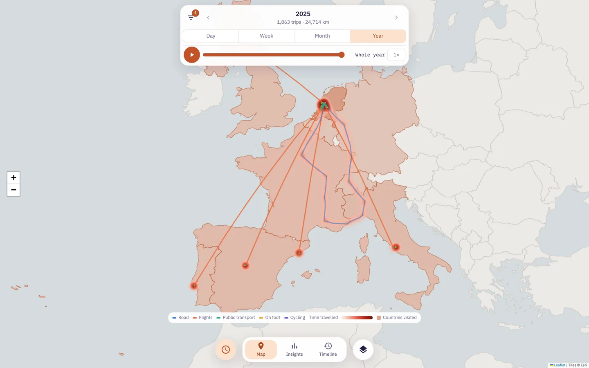
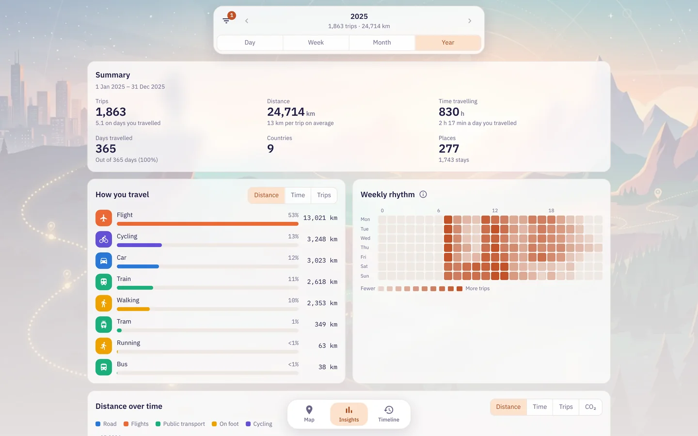
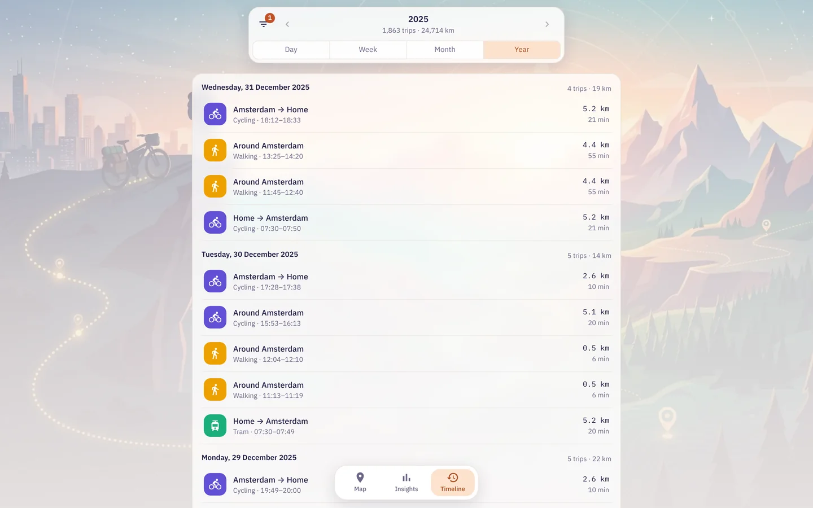
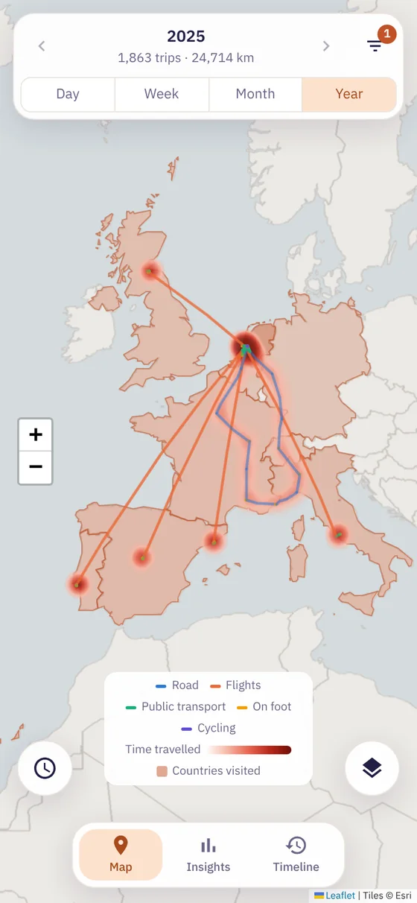
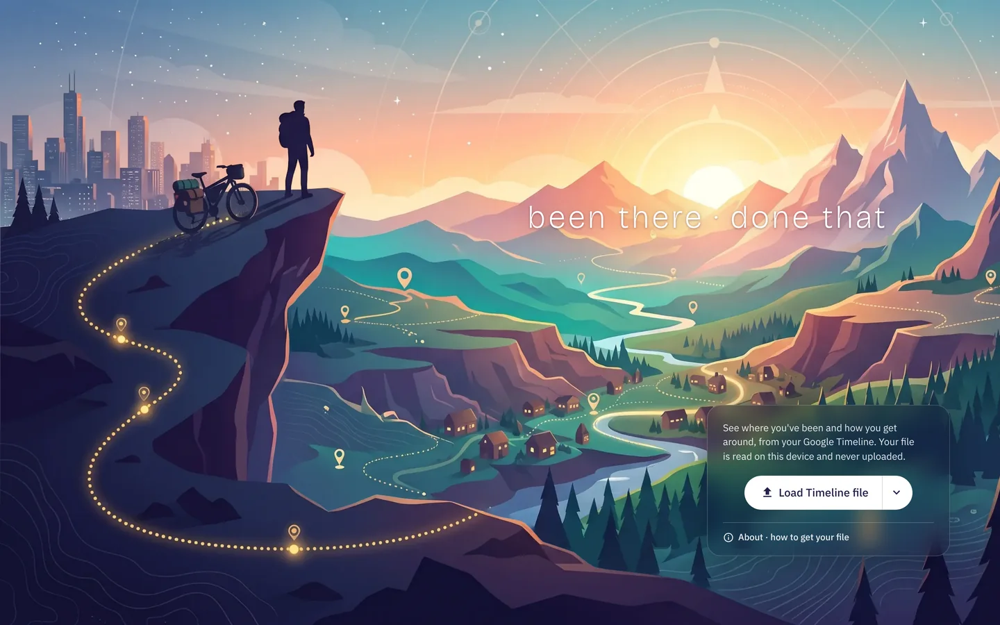

# BT•DT (Been There · Done That)

**A heatmap of everywhere you've been, from your Google Timeline and much more.** Load the Timeline file from your phone, your Garmin, Fitbit or Strava activities, or any GPX, KML, GeoJSON or FIT track, and BT•DT draws every trip, flight and country on a map, lists your days as a timeline, and shows how you get around and what it costs in CO₂. It runs in your browser: your file is read on your device and never uploaded.

### [Open BT•DT →](https://bluehair-co.github.io/btdt/)

Free, no account, no tracking. Works on Android, iPhone, Mac and PC, and installs as an app that opens offline.

Screenshots use made-up demo data. The basemap in them is drawn from the app's built-in country borders; the live app uses Esri map tiles.

## What you get

- **Map.** Every trip drawn along its GPS points and coloured by transport, a heatmap of where you spend your time travelling or staying, countries visited, and your regular places. Play a day, week, month or year back on the time slider.
- **Insights.** Trips, distance, time on the move, countries and places for any period; how you travel by distance, time or trips; your weekly rhythm; distance and CO₂ over time.
- **Timeline.** Every trip, day by day, with where it started and ended, the transport, the distance and the time. Open a trip for its details and raw data.
- **Filters and export.** Narrow by dates, time of day, transport and country, then download what matches as JSON or CSV.
- **Cleaner data than Google's.** Bad GPS jumps, stale start and end points, time parked counted as driving and places Google moved are fixed, and loose GPS points become trips. Fixed trips are flagged in their details.
- **Dawarich too.** Load an export from [Dawarich](https://dawarich.app), the self-hosted location history app: trips and stays are worked out from its GPS points.
- **Strava too.** Load your Strava export and its activities replace the Timeline trips they cover, keeping their sport, name and gear, with a card for how far each bike and pair of shoes went.
- **Garmin, Fitbit and any GPS file.** Garmin Connect exports, `.fit`, `.tcx`, `.gpx`, `.kml`/`.kmz` and `.geojson` files from Garmin, Fitbit, Komoot, Polar, Suunto, Coros, Wahoo, OsmAnd and most trackers. A recorded activity keeps its sport and full track like a Strava one; a log of whole days has its trips and stays worked out from its points.
- **Heart rate.** Activities that recorded heart rate show time in each zone and a chart coloured by zone, heart rate paths colour the map by effort, and Insights tracks your fitness: your heart rate at your usual speed, month by month.

| Insights | Timeline | On a phone |
| --- | --- | --- |
|  |  |  |

## How to use it

1. **Export your Timeline.**
   - **Android:** Settings → Location → Location services → Timeline → *Export Timeline data*, and save `Timeline.json`.
   - **iPhone:** in Google Maps, tap your profile picture → Settings → Personal content → *Export Timeline data*.
   - **Older Google Takeout:** if you downloaded Location History from takeout.google.com before Timeline moved onto phones, `Records.json` and the *Semantic Location History* folder work too, on their own or together with `Timeline.json`.
2. **Open [bluehair-co.github.io/btdt](https://bluehair-co.github.io/btdt/)** and tap *Load location files* (or *Load a whole folder* on a computer).
3. **Explore.** Switch between Map, Insights and Timeline, pick a day, week, month or year, and use the layers button to turn the heatmap, countries and places on or off.
4. **Keep it.** Your last import is saved in the browser, so the app opens with it next time. Choose *Add to Home screen* (phone) or *Install* (desktop browser) to use it like an app, offline.

Want to look around first? Tap *Try the demo* under the Load button: it opens three made-up years of someone living in Amsterdam, with holidays on four continents. Nothing is saved, and *Exit demo* takes you back.

To load **Dawarich** data, tap *Load location files* and pick the ZIP Dawarich gives you: either an export from the Points page (GeoJSON or GPX), or *Export my data* from Dawarich's settings, which also brings your visits' names and Dawarich's transport types. Load it on its own or together with your Google Timeline.

To add Strava, tap *Load location files* (or Settings → *Load activities*) and pick the ZIP from Strava (Settings → My Account → Download or Delete Your Account). Garmin's account export ZIP (Account → Data Management → Export Your Data) loads the same way, and so do single `.fit`, `.gpx`, `.tcx`, `.kml`, `.kmz` and `.geojson` files.

## Privacy

There is no server. Your files are read by JavaScript in your browser and saved only in that browser's storage; clearing the site's data removes them. The only things fetched from the internet are the map tiles (Esri), the map library and the fonts.

## For developers

- The files at the top of this repository are the published app (`index.html`, the manifest, the service worker, icons, the share image, `robots.txt` and `sitemap.xml`), served by GitHub Pages.
- `source/` holds the source and the build script: `python3 source/build.py` rebuilds into `source/dist/`, which is then copied to the top level. Bump `VERSION` in `sw.js` whenever a deployed file changes so installed copies update.
- `source/README.md` explains how the data is read and cleaned: bad GPS jumps, trips that disagree with their stays, places Google moved, Records.json under Timeline, time zones and countries.

## License

BT•DT is by [BlueHair](https://www.bluehair.co) and licensed under [CC BY-NC 4.0](https://creativecommons.org/licenses/by-nc/4.0/): anyone may use, copy and change it for non-commercial purposes, as long as they credit the original ("Based on BT•DT by BlueHair, www.bluehair.co"). See `LICENSE`. The BlueHair name and logo are not covered.

Third-party parts keep their own licenses: Leaflet (BSD 2-Clause), Esri map tiles (Esri terms of use), Natural Earth borders and OurAirports airports (public domain), GeoNames towns (CC BY 4.0), the IANA time zone database (public domain), UK government conversion factors (Open Government Licence v3.0), and Bricolage Grotesque and IBM Plex fonts (SIL Open Font License).
